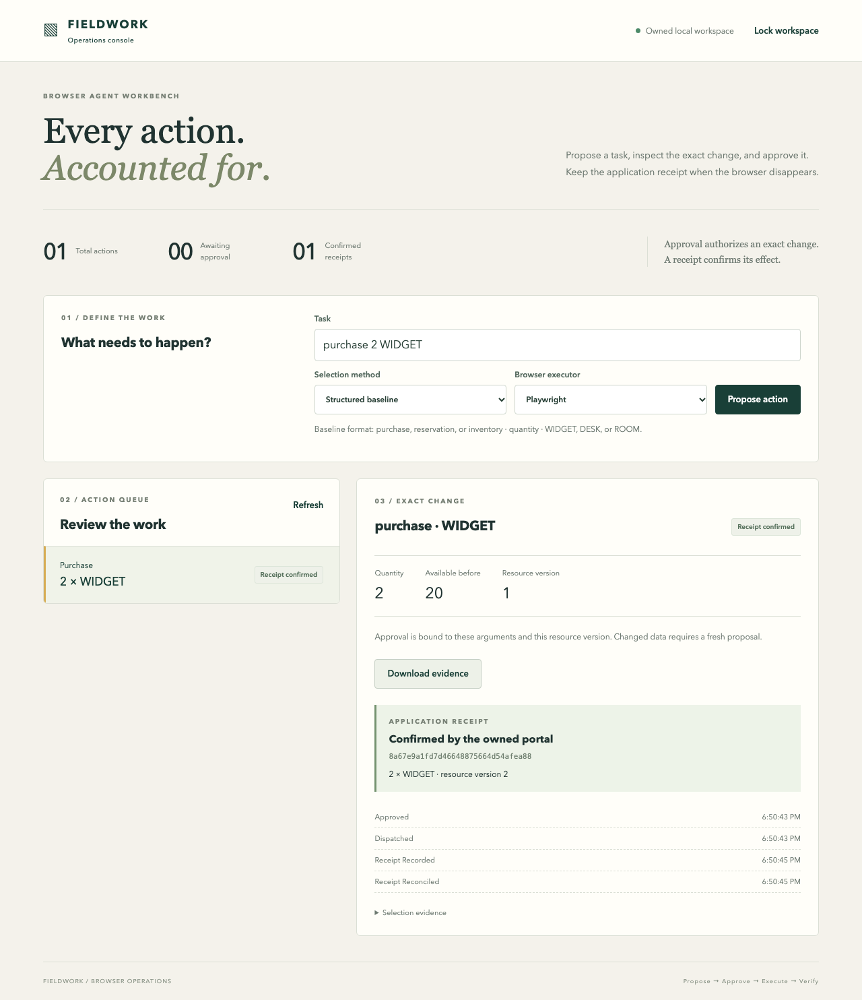

# Browser Agent Workbench

**An operations console for approved browser actions, durable receipts, and recovery.**

Turn a task into a purchase requisition, reservation, or inventory adjustment in an owned portal. Inspect the exact arguments and resource version before approving. Execute with Playwright, Browser Use, or a pinned Playwright MCP adapter. If the browser disappears after submission, reconcile the application receipt instead of submitting again.

The reference environment operates on local fixtures. It never purchases goods or signs into third-party accounts.



## Run locally

Use Python 3.11+ and Node 20+. The full integration profile includes Browser Use 0.1.18 and its pinned dependencies; the smaller `requirements.txt` supports the native Playwright and PostgreSQL paths.

```sh
python3.11 -m venv .venv
source .venv/bin/activate
pip install -r requirements-browser-use.lock
python -m playwright install chromium
npm --prefix frontend ci
npm --prefix frontend run build
npm --prefix adapters/playwright-mcp ci
export WORKBENCH_KEY="$(python -c 'import secrets; print(secrets.token_urlsafe(32))')"
export CHROMIUM_PATH="$(python -c 'from playwright.sync_api import sync_playwright; p=sync_playwright().start(); print(p.chromium.executable_path); p.stop()')"
python -m workbench.server
```

Open **http://127.0.0.1:18120** and enter the value of your local operator key. Keep that key outside the repository. The UI retains it in page memory and clears it when locked. It does not persist credentials in browser storage. `npm --prefix frontend run dev` rebuilds files on changes; the Python service remains the single web server.

Try `purchase 2 WIDGET`, `reservation 1 ROOM`, or `inventory 3 DESK` in structured baseline mode. The local language model mode accepts natural language and proposes a typed action. Neither mode approves its own proposal. Approve the exact change, run it, then download its checksummed evidence.

### Local model endpoint

Provide an OpenAI-compatible **loopback** chat-completions server. The workbench actually calls it; there is no deterministic fallback hidden behind model mode.

```sh
export MODEL_ENDPOINT=http://127.0.0.1:18100
# For a Qwen3 endpoint with bounded non-thinking generation:
export MODEL_NO_THINK=1
```

The endpoint receives `model=default_model`; configure that alias on the inference server. No inference server or weights are bundled. See [model provenance and evaluation](docs/evaluation.md) for the exact measured checkpoints, limitations, and independent setup guidance. Docker demonstrates the structured browser workflow; native execution is the verified local-model configuration.

### PostgreSQL

Pass a PostgreSQL connection string through `--database`. SQLite remains a portable development backend. PostgreSQL uses database-level transaction locks, so independent worker processes share duplicate prevention; it does not rely on an in-memory mutex.

```sh
python -m workbench.server --database "$WORKBENCH_DATABASE_URL"
```

`WORKBENCH_KEY=your-local-key docker compose up --build` starts the application and an isolated PostgreSQL service. Only the application port is published, on loopback. The compose database credential is a disposable fixture credential. The compatibility container explicitly disables the Chromium sandbox because common container kernels do not provide its namespace sandbox; use it only with the owned fixture portal. Native execution keeps Chromium's sandbox. See [security boundaries](docs/security.md).

## What is verified

- Exact, expiring approvals bind operator, action ID, kind, arguments, and resource version.
- A single transaction records the business effect and receipt. Duplicate delivery produces one effect.
- A real Chromium process is killed after the server commits a POST but before the browser receives confirmation. Reconciliation finds the original receipt.
- Missing receipts remain `outcome_unknown`; dispatch and replay are refused.
- Changed arguments, changed resource versions, expired sessions, cancellation and changed layouts prevent unapproved effects.
- Real page-script approval forgery is rejected. Browser HTTP requests are restricted to the owned origin, and WebSocket and service-worker channels are blocked.
- Actual Browser Use controller and Playwright MCP stdio tools execute portal transactions.
- PostgreSQL duplicate delivery is exercised by independent processes, including rollback when a worker exits mid-transaction.
- The React approval-to-receipt workflow and evidence download run in a real browser, including a mobile viewport.

This is a bounded reference implementation, not a general web agent or a claim of production readiness. Review [architecture](docs/architecture.md), [operations](docs/runbook.md), [demo](docs/demo.md), [API](docs/api.md), and [measured model results](docs/evaluation.md).

## Verify

```sh
python -m unittest discover -s tests -v
RUN_BROWSER_TESTS=1 RUN_BROWSER_USE_TESTS=1 RUN_MCP_TESTS=1 RUN_UI_TESTS=1 \
  TEST_POSTGRES_DSN="$WORKBENCH_TEST_DATABASE_URL" \
  python -m unittest discover -s tests -v
python -m workbench.evaluation --endpoint http://127.0.0.1:18100 \
  --adapter browser-use --output artifacts/evaluation.json
```

Create `artifacts/` before the evaluation command. Core tests clearly skip unavailable integration profiles; a skipped integration is not passing evidence. Use a dedicated PostgreSQL test database. The evaluation harness uses a fixture oracle to approve only the expected business intent; a real operator must perform that review in the application.

## License and upstream attribution

MIT for workbench code. Browser Use, Playwright, Playwright MCP, React, and the model runtimes retain their upstream licenses. The workbench composes these tools; it does not reproduce or claim authorship of upstream implementations. Exact dependency and model profiles are recorded in [dependencies](docs/dependencies.md).

Operator identities are stored and compared exactly, including case and Unicode. They must contain nonblank text, be at most 128 characters, and exclude control characters and unpaired Unicode surrogates. Approval lifetimes must be finite and nonnegative; zero expires immediately and values above 300 seconds are capped.
