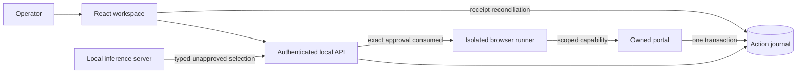
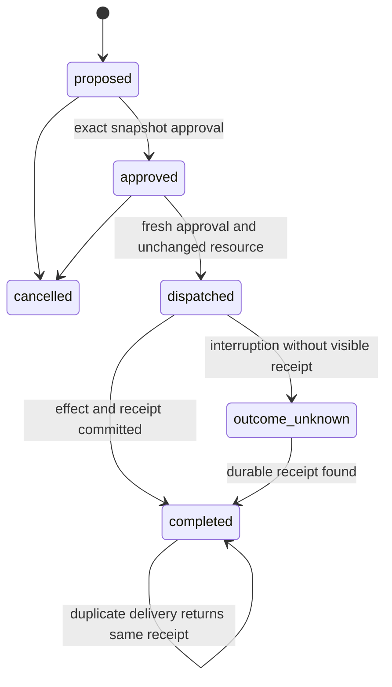

# Architecture and guarantees

The operator, model output, browser page, and transaction store have separate authority. A model produces an unapproved proposal. The operator approves the exact action snapshot. A browser receives a short-lived capability for that action alone. The owned portal rechecks the capability, exact arguments, resource version, state and expiry inside the transaction that records the effect.

An `outcome_unknown` action is never re-dispatched. A failed or expired approval requires a new proposal. The system does not infer a successful rollback from a browser timeout. Completed receipts survive API or browser restarts.

## Database boundary

Resources, actions, model decision evidence, receipts and events share one database. Decision evidence is bound to its action in the proposal transaction and survives service or workspace restarts. Each receipt has a unique action ID. SQLite uses WAL and `BEGIN IMMEDIATE`. PostgreSQL takes an exclusive lock over the resource/action tables for the critical transaction; this deliberately trades throughput for clear cross-process correctness. A worker crash before commit rolls back inventory. A crash after commit leaves a receipt that reconciliation can find. This coarse locking is appropriate for a single operator reference environment; it is not a capacity claim.

Purchase and reservation both reduce the fixture's available quantity; inventory adds stock. These are synthetic operations on seeded WIDGET, DESK and ROOM resources. Purchase does not charge money, and reservation has no external calendar integration.

## Browser adapters

Native Playwright uses a fresh Chromium profile and browser context for every action. Browser Use 0.1.18 supplies an actual BrowserContext and Controller; its unrestricted default actions are removed and replaced with two approved form actions. The adapter overrides the pinned context factory to block service workers before navigation.

Playwright MCP 0.0.3 uses a separate Node stdio server. Python performs initialization, capability discovery, navigation, typing and clicking through JSON-RPC tools. The wrapper composes pinned internal server/context interfaces because that package's early exports differ from later releases. It provides a version-specific compatibility path, not a promise that arbitrary later MCP packages are interchangeable. Only the selected browser tools are exposed. Receipt text is verified against the approved action ID and arguments.

The same transactional receipt gate is the final authority for every adapter. A tool's successful click response is not a completed business operation.

## Bounds

One browser action executes per API process. HTTP admission is capped at 16 concurrent connections, request bodies at 16 KiB, and socket reads at three seconds. Browser actions use bounded waits; local inference uses a 90-second request timeout and 180 generation tokens. These are reference defaults rather than production sizing results. Horizontal workers remain serialized at the database transaction boundary.

The API is a single-operator service with one local bearer key. Store-level ownership is enforced, but a full multi-tenant identity provider, role administration and external approval delegation are outside this implementation.
